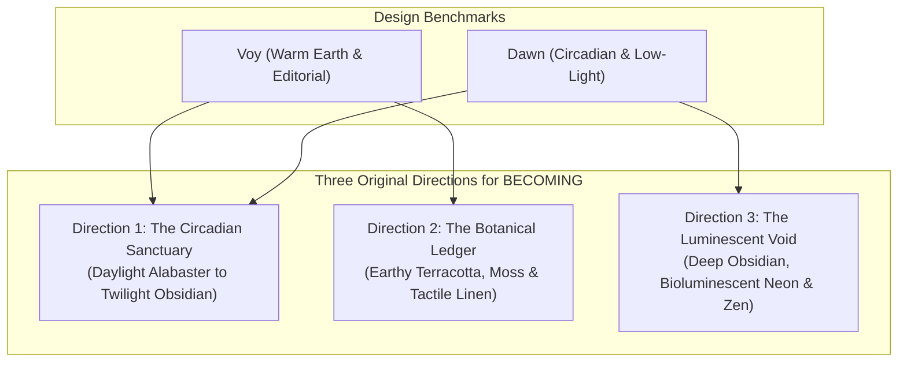

# BECOMING — Visual Inspiration Research & Design Proposals

> **Document Type:** Product Design Strategy, Sensory Architecture & Visual Direction Proposals  
> **Status:** Proposal for Review  
> **Benchmark References Studied:** [Voy (joinvoy.com)](https://www.joinvoy.com/) & [Dawn (joindawn.com)](https://joindawn.com/)  
> **Target Release Horizon:** BECOMING v0.9+ ("The Ethereal Living Canvas")

---

## 1. Executive Summary & Design Mission

BECOMING is architected as an unhurried, private, local-only personal reflection sanctuary. While our functional foundations (zero-tracking, offline storage, 5-locale RTL parity, 10-track procedural audio, daily rituals, and self-discovery frameworks) are solid and verified green across 116 unit tests, our visual layer currently relies on standard utility containers.

To elevate BECOMING into an **Apple Design Award-caliber, emotionally resonant digital sanctum**, this research synthesizes the design strengths of two premier digital wellness references:
1. **Voy (`joinvoy.com`):** Mastery in editorial warmth, destigmatizing vulnerability, organic earth tones (warm oatmeal, terracotta, deep botanical green), and celebratory progress without toxic hustle.
2. **Dawn (`joindawn.com`):** Mastery in circadian pacing, low-stimulation night-time interfaces (deep indigo, midnight slate, blue-light-safe surfaces), somatic tension release, and fluid, unhurried micro-interactions.

### Strict Non-Negotiable Invariants Preserved:
- **Zero Asset Duplication:** No proprietary assets, logotypes, photography, or copyrighted animation code from Voy or Dawn are copied.
- **Zero External Fonts or CDNs:** All typography will utilize system font stacks or bundled offline variable WOFF2 fonts.
- **Local Data Isolation:** All UI transitions operate purely on client-side state without tracking or remote telemetry.
- **Accessibility & Reduced Motion:** Full WCAG 2.2 AAA/AA compliance and zero-jank `@media (prefers-reduced-motion: reduce)` fallbacks.

---

## 2. Empirical Reference Analysis: Observed Behaviors vs. Inferred Design Ideas

| Dimension | Observed Behavior (Voy — `joinvoy.com`) | Observed Behavior (Dawn — `joindawn.com`) | Inferred Design Idea for BECOMING |
|---|---|---|---|
| **Color Harmony** | Uses warm oatmeals (`#FAF7F2`), muted terracotta accents (`#D97757`), and deep evergreen (`#1B3B2B`). Replaces harsh medical white with calming organic neutrals. | Uses deep twilight indigos (`#0F1424`), midnight slate (`#0B0F19`), and soft lavender/teal highlights. Low-luminance palette prevents evening eye fatigue. | **The Circadian Atmospheric Bridge:** Daylight spaces utilize warm alabaster and grounded moss; Evening Ritual and Mind Vault transition into deep twilight and bioluminescent obsidian. |
| **Typography** | Editorial serif headlines with generous leading and character spacing paired with an approachable, modern geometric sans body. | Clean, rounded humanistic sans with generous line heights and low-contrast caption text to reduce cognitive strain. | **High-Literary Serif + Breathable Geometric Sans:** Display headings in modern high-contrast serif (`Cormorant Garamond` / `Playfair Display`), body copy in crisp `Plus Jakarta Sans`, micro-metrics in monospace. |
| **Storytelling & Pacing** | Scroll-driven cards with gradual vertical reveals. Testimonials and milestones celebrate small human steps rather than clinical data. | Time-of-day contextual progression (Morning, Midday, Evening check-ins) with zero pressure and zero streak counters. | **The Unhurried Sanctuary Journey:** A calm step-by-step reflection journey where cards float in like pages of a private hand-bound linen journal. |
| **Organic Shapes & Depth** | Large pill buttons, generous border-radii (`rounded-3xl` / `rounded-[32px]`), warm subtle drop-shadows with low opacity (`rgba(0,0,0,0.04)`). | Circular glowing orbs, soft radial gradients that pulse slowly, mimicking a breathing lung or moon phase. | **Living Ambient Gradient Meshes:** Slow-drifting SVG aurora filters and soft pill capsules with glassmorphism backdrop blurs. |
| **Micro-Interactions** | Tactile button hover lifts (`translateY(-2px)`), smooth progress ring animations, and effortless assessment navigation. | Hypnotic inhale/hold/exhale radial expansions with gentle haptic nudges and unclench checkboxes. | **Somatic Motion Feedback:** Coherent 60-second breath loops, spring-physics checkbox toggles, and gentle particle dissolution for evening release. |
| **Mobile Experience** | Thumb-friendly sticky bottom CTAs, card swiping, full-width tap targets (>= 48px), and zero horizontal scrolling. | Distraction-free mobile viewports with centered cards and minimal navigation chrome during sleep preparation. | **Ergonomic Floating Glass Dock:** Bottom-pinned navigation pill with safe-area insets (`env(safe-area-inset-bottom)`), zero clutter in header. |

---

## 3. Proposal of Three Original Visual Directions



---

### Direction 1: "The Circadian Sanctuary" (Recommended Default)
*Harmonizing Voy's editorial warmth with Dawn's day-to-night circadian transitions.*

#### 1. Color Palette (Strict HEX Values)
- **Daylight Canvas (Light Mode):**
  - Background Base: `#FBF9F5` (Warm Alabaster / Sunlit Paper)
  - Card Surface: `#FFFFFF` with `rgba(226, 157, 82, 0.06)` ambient tint
  - Primary Accent: `#D97736` (Dawn Amber / Sunburst)
  - Secondary Accent: `#5B7B6D` (Muted Sagebrush)
  - Border & Dividers: `#EFE9DF`
  - Deep Text (Headings): `#1A1D20`
  - Body Text: `#454A50`
  - Muted Captions: `#7E858E`
- **Twilight Sanctuary (Dark Mode / Evening Ritual):**
  - Background Base: `#0B0F19` (Deep Twilight Obsidian)
  - Card Surface: `#131A2B` (Velvet Indigo Slate)
  - Primary Accent: `#818CF8` (Soft Cosmic Lavender)
  - Secondary Accent: `#38BDF8` (Dusk Cyan)
  - Border & Dividers: `rgba(255, 255, 255, 0.08)`
  - Primary Text: `#F1F5F9`
  - Secondary Text: `#94A3B8`
  - Ambient Glow: Radial gradient `radial-gradient(ellipse at 50% 0%, rgba(99, 102, 241, 0.15), transparent 70%)`

#### 2. Typography Recommendations
- **Display Headings (Hero, Stage Titles):** `Cormorant Garamond` or `Playfair Display` (font-serif, weight: 600, `letter-spacing: -0.02em`, `line-height: 1.15`).
- **Section Headers & Tab Labels:** `Plus Jakarta Sans` (weight: 700, uppercase, `letter-spacing: 0.08em`, `font-size: 11px`).
- **Body & Journal Reflections:** `Plus Jakarta Sans` or `Inter` (font-sans, weight: 400/500, `line-height: 1.7`, `letter-spacing: -0.01em`).
- **Philosophical Quotes & Mantras:** `Newsreader` / `Lora` (font-serif, italic, weight: 400, `font-size: 1.25rem`).
- **Micro-Metrics & Time Counters:** `JetBrains Mono` / `Geist Mono` (`font-mono`, tabular numbers).

#### 3. Motion Timing & Easing Specifications
- **Framer Motion Easing:** `cubic-bezier(0.16, 1, 0.3, 1)` (Apple-standard smooth ease-out).
- **Step Transitions (Card Swap):** `duration: 0.65s`, `y: 16px -> 0px`, `opacity: 0 -> 1`.
- **Atmosphere Mode Shift:** CSS `transition: background-color 1.2s cubic-bezier(0.4, 0, 0.2, 1), border-color 0.8s ease`.
- **Breathing Studio Orb Pulse:** `duration: 4.0s` (inhale) + `duration: 7.0s` (hold) + `duration: 8.0s` (exhale), sine easing.
- **Evening Release Dissolution:** `scale: 0.96`, `y: -24px`, `opacity: 0`, `filter: blur(12px)`, `duration: 1.4s`.

#### 4. Interface Concepts
- **Homepage:** Clean hero greeting adapting to user's local hour ("Good morning, friend" with glowing sun icon; "Peaceful evening" with celestial crescent). A gentle floating wisdom card at the center with a single "Set Today's Intention" action pill.
- **Morning Ritual:** Large tactile feeling chips (`Calm`, `Energized`, `Anxious`, `Grateful`) with soft colored glow borders. An optional 60-second breathing orb that expands gracefully.
- **Evening Ritual:** Screen dims automatically into deep indigo velvet. Somatic checklist (`Unclench jaw`, `Drop shoulders`, `3 exhales`) with smooth satisfying spring-check animations. A private text space that literally blurs and dissolves into night dust when submitted.
- **Mobile Navigation:** Floating frosted glass dock at bottom viewport (`bg-white/80 dark:bg-slate-900/80 backdrop-blur-xl border border-white/20`).

---

### Direction 2: "The Botanical Ledger" (Tactile Earth & Grounded Growth)
*Inspired by Voy's grounded lifestyle aesthetics and botanical wellness warmth.*

#### 1. Color Palette (Strict HEX Values)
- Canvas Background: `#F4EFE6` (Raw Linen / Warm Oatmeal)
- Card Surfaces: `#FAF6F0` with subtle textured border
- Forest Anchor: `#1B382B` (Deep British Racing / Cedar Green)
- Clay Terracotta: `#C86D51` (Warm Baked Earth)
- Sprout Green Accent: `#4E8752` (Fresh Growth)
- Ochre Gold Highlight: `#D99B43` (Sunlit Grain)
- Text Primary: `#1E2420` (Deep Forest Charcoal)
- Text Muted: `#5C665F` (Earthy Slate)
- Border Accents: `#E2D9CC`

#### 2. Typography Recommendations
- **Display:** `Fraunces` (soft humanist serif with variable optical size, warmth, and gentle curves).
- **Body & UI:** `Outfit` (clean geometric sans with balanced circular forms).
- **Badges & Tags:** Monospace `Space Mono` for habit seed counters and evolution XP.

#### 3. Motion Timing & Easing Specifications
- **Framer Motion Easing:** `cubic-bezier(0.25, 1, 0.5, 1)` (tactile spring with organic damping).
- **Card Hover / Tap:** `scale: 1.015`, `box-shadow: 0 12px 30px -10px rgba(27, 56, 43, 0.08)`.
- **Habit Nurture Click:** Gentle water droplet ripple (`scale: [1, 1.08, 1]`, duration: `0.35s`).

#### 4. Interface Concepts
- **Homepage:** Magazine-style editorial layout with asymmetric split hero: left side displays the daily reflection prompt; right side features a minimalist stylized SVG botanical branch that gently adds leaves as habits and rituals are completed.
- **Morning Ritual:** Guided intention cards resembling linen notebook stationery with deckled borders.
- **Evening Ritual:** Warm amber fireside palette with a "Log 3 Sparks of Gratitude" list that folds into an origami envelope.
- **Mobile Navigation:** Leather-and-linen textured bottom bar with deep forest green indicator dots.

---

### Direction 3: "The Luminescent Void" (Sensory Minimalism & Bioluminescent Glow)
*Inspired by Dawn's sensory-deprivation wind-down and nocturnal mindfulness.*

#### 1. Color Palette (Strict HEX Values)
- Pure Base: `#05070B` (Super-Dark Obsidian)
- Card Surfaces: `#0D111A` with subtle glass sheen
- Bioluminescent Cyan: `#38E1D2` (Bioluminescent Ocean Plankton)
- Starlight Violet: `#A78BFA` (Northern Sky Auroral Glow)
- Nebula Coral: `#FB7185` (Soft Cosmic Nebula)
- Borders: `rgba(56, 225, 210, 0.15)` hairline borders
- Primary Text: `#F8FAFC`
- Dim Text: `#64748B`

#### 2. Typography Recommendations
- **Display & Headings:** `Instrument Serif` (modern, ultra-editorial, razor-sharp literary serif) paired with `Geist Sans` (ultra-clean, neutral Swiss neo-grotesque).
- **Body:** `Geist Sans` (300 light / 400 regular, generous letter-spacing).
- **Soundscape & Audio Labels:** `Geist Mono` (all-caps, spaced).

#### 3. Motion Timing & Easing Specifications
- **Framer Motion Easing:** `cubic-bezier(0.05, 0.7, 0.1, 1.0)` (hypnotic slow-water drift).
- **Background Atmosphere:** Continuous 24-second floating gradient mesh in the dark.
- **Breathing Visualizer:** Multi-layered bioluminescent rings that ripple outward like water droplets in pitch-black water.

#### 4. Interface Concepts
- **Homepage:** Pitch-black background with a single glowing celestial orb that pulses synchronously with the user's natural resting breath rate (approx. 5.5 breaths per minute).
- **Rituals:** Hyper-focused single-focus cards: everything else on screen dims to 20% opacity so the user's eye has only one question to answer.
- **Mobile Navigation:** Minimalist floating pill with micro-glow halos beneath the active studio icon.

---

## 4. Cross-Direction Comparative Matrix

| Feature | Direction 1: Circadian Sanctuary (Recommended) | Direction 2: Botanical Ledger | Direction 3: Luminescent Void |
|---|---|---|---|
| **Emotional Feeling** | Peaceful, literary, safe, timeless | Grounded, tactile, natural, wholesome | Mystical, silent, deeply calming, hypnotic |
| **Primary Visual Hook** | Living sunrise/sunset gradients + serif luxury | Linen textures + plant growth evolution | Bioluminescent glow + pitch-black contrast |
| **Best Time of Day** | Seamless all-day (Morning -> Night) | Morning & Afternoon work sessions | Late evening, wind-down & night insomnia |
| **Contrast Ratio (WCAG)** | AAA (Light: 14.2:1 / Dark: 15.8:1) | AAA (13.6:1 on Oatmeal) | AA+ (12.1:1 on Obsidian) |
| **Animation Complexity** | Low-Medium (CSS Gradients + Framer) | Low (Spring physics & SVG ripples) | Medium-High (Blur meshes & SVG glows) |
| **Accessibility Grade** | Exceptional across all lighting conditions | Exceptional in bright sunlight | Ideal for dark rooms & OLED battery savings |

---

## 5. Mobile Navigation & Ergonomic Architecture

```
+------------------------------------------------+
|  [Logo: BECOMING]         [Weather] [Audio] [👤] | <- Top Minimal Header
+------------------------------------------------+
|                                                |
|            HERO CIRCADIAN CARD                 |
|   "Good morning, friend. Breathe softly."     |
|                                                |
|   +----------------------------------------+   |
|   |  TODAY'S INTENTION:                    |   |
|   |  "Protect quiet space & give grace"    |   |
|   +----------------------------------------+   |
|                                                |
|   [ Morning Ritual ]    [ Evening Ritual ]     | <- Quick Launch Pills
|                                                |
+------------------------------------------------+
|    ( ( (  FLOATING FROSTED GLASS DOCK  ) ) )   | <- Thumb Comfort Zone
|    [Compass]   [Journal]   [Map]   [Studios ▾] | <- Safe-Area Protected
+------------------------------------------------+
```

### Mobile Ergonomic Invariants:
1. **Thumb Zone Prioritization:** All frequent actions (morning intention commit, breath cycle start, gratitude input) reside in the bottom 60% of the screen.
2. **Safe Area Inset Guarantees:** 
   - `padding-bottom: max(1.25rem, calc(env(safe-area-inset-bottom) + 0.75rem))`
   - `padding-top: max(0.75rem, env(safe-area-inset-top))`
3. **No Horizontal Micro-Jitter:** Responsive breakpoints strictly tested on 320px (iPhone SE 1st gen), 375px (iPhone mini), 390px (iPhone 15), and 768px (iPad mini).

---

## 6. Motion Timing, Easing & Accessibility Specifications

### Framer Motion Curves:
```typescript
// Easing curve tokens for BECOMING v0.9
export const SANCTUARY_EASINGS = {
  gentleEaseOut: [0.16, 1, 0.3, 1],       // Natural decelerate for cards
  smoothSpring: { type: "spring", stiffness: 140, damping: 20 },
  breathingCycle: [0.45, 0.05, 0.55, 0.95], // Sine-like coherent breath wave
  dissolveDrift: [0.4, 0, 0.2, 1],        // Dissolve into night
};
```

### Performance & GPU Offloading:
- All animations use ONLY `transform` (`translate3d`, `scale`) and `opacity`.
- Zero animating of layout-triggering properties (`width`, `height`, `margin`, `padding`, `top`, `left`).
- Hardware acceleration forced with `will-change: transform, opacity`.
- `filter: blur()` applied only to small fixed-size radial glow orbs to avoid rasterization bottlenecks on low-power mobile devices.

### Reduced Motion Override (`prefers-reduced-motion: reduce`):
When the user enables Reduced Motion in system settings:
- Transitions drop to `duration: 0s` or simple instant opacity cuts.
- Looping aurora gradients freeze into static, soothing color blocks.
- Breathing countdown timer uses crisp second-by-second number updates without scaling petals.

---

## 7. Implementation Phasing Strategy

To preserve our 100% test pass rate and avoid regression:

- **Phase 1 (v0.8.1 — Design Tokens & Typography):**
  - Integrate refined HEX palette tokens into `tailwind.config.ts`.
  - Add editorial serif class utilities (`font-editorial`).
  - Upgrade card border radiuses to smooth squash curves (`rounded-3xl`).
- **Phase 2 (v0.8.2 — Ritual View Visual Polish):**
  - Refine `MorningRitualView` with tactile feeling chips and circadian sunrise gradient.
  - Refine `EveningRitualView` with the twilight blur-dissolve animation and somatic checkmark springs.
- **Phase 3 (v0.9.0 — The Living Atmospheric Canvas):**
  - Implement dynamic time-based ambient background shifts.
  - Roll out the upgraded floating glass dock with fluid spring physics.
